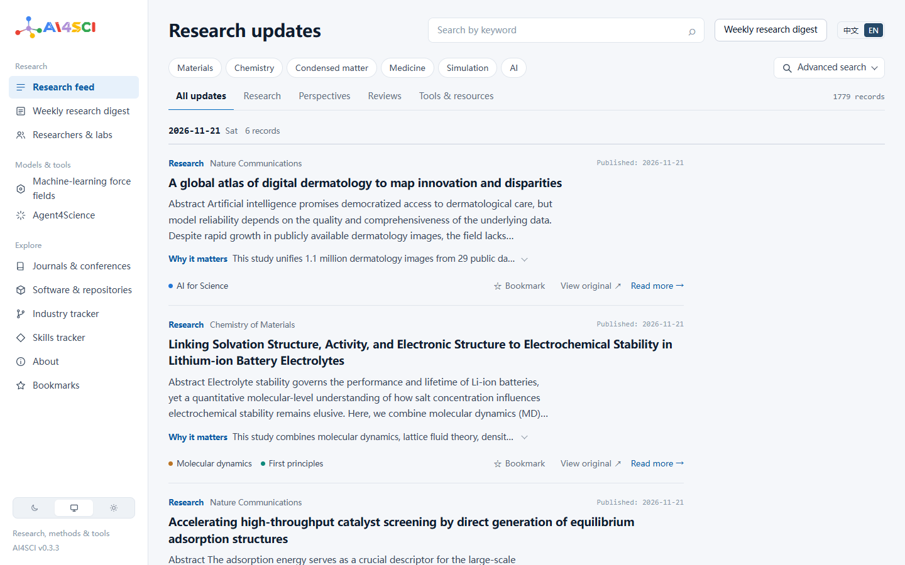
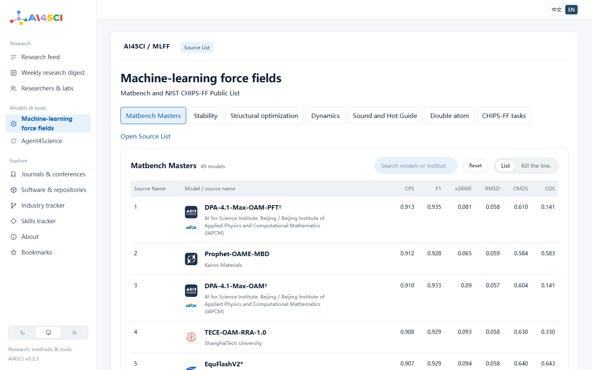

  <picture>
    <source media="(prefers-color-scheme: dark)" srcset="assets/wordmark-dark.svg">
    
  </picture>

**[简体中文](README.md) · English**

# Special: Four years of foundation models for interatomic potentials (2022.11.28–2026.11.28)

| Claude Fable 5.2 | GPT6 Astra | Gemini 4 Carbon |
| --- | --- | --- |
| https://github.com/user-attachments/assets/4610ac1d-d926-491c-8ffc-de0dc898e112 | https://github.com/user-attachments/assets/86a9e26b-ca36-411a-8f7b-0b2ac91dc5b8 | https://github.com/user-attachments/assets/6dc35325-f65d-46ca-ac2b-98ac35aeb865 |

[Read the original video production prompt in Chinese](README.md).

# AI4SCI · Research intelligence for computational science and industrial simulation

AI4SCI curates research that uses AI or scientific computing in materials science, chemistry, medicine, condensed-matter physics, and related industrial applications. It also tracks benchmarks, software releases, and industry research. Follow the source links to the paper, benchmark, or official announcement.

**[Open the English site][home] · [打开中文站](https://ai4scihot.8-220-189-127.sslip.io/ai4scihot?lang=zh) · [Suggest a source][suggest]**

Use the site’s language switch to browse the same sections in English or Chinese. English paper pages show the author’s original abstract where available. The Chinese edition provides abstract translations and explains why papers are worth reading. Selected open-access papers also have reading guides.

[][home]

*English desktop site, captured November 22, 2026.*

## Explore AI4SCI

| Section | What you can do |
| --- | --- |
| [Research feed][home] | Browse by original publication date and narrow the results by field, method, or keyword. |
| [Weekly research digest][weekly] | Pick a week to catch up on selected research. |
| [Researchers & labs][groups] | Find groups by name, institution, or research area and open their homepages. |
| [Machine-learning force fields][mlff] | Start with Matbench Discovery, browse source leaderboards for tasks such as stability, structure relaxation, dynamics, phonons, and thermal conductivity, or explore NIST CHIPS-FF. |
| [Agent4Science][agents] | Explore agents, tools, and papers by research task, including experiment design and data analysis. |
| [Journals & conferences][journals] | Browse journals and proceedings by publisher and find their official pages. |
| [Software][software] and [repositories][repositories] | Switch between the two directories to find projects such as VASP, LAMMPS, MOOSE, or FAIRChem, see when they were last checked, and follow official updates. |
| [Industry tracker][industry] | Filter updates in materials, chemistry, and drug discovery by company or research task and follow the official evidence. |
| [Skills tracker][skills] | Find research skills collections such as Academic Research Skills and Nature Skills, along with their official releases where available. |
| [Bookmarks][bookmarks] | Reopen saved items. Bookmarks are stored in the current browser. |

## Three ways to use AI4SCI

### Read a paper, from the research question to the original source

Suppose you are looking at molecular simulation for drug delivery. Start in the [research feed][home] with the medicine and simulation filters. Open a paper and read the abstract to see what the authors simulated and what their results support. Follow the paper link to check the methods and conditions. If you want to discuss it at a lab meeting, [bookmark it][bookmarks]. Bookmarks are stored in the current browser.

AI4SCI organizes research by original publication date. It uses the author’s abstract to check the subject, the AI or simulation methods used, and the main findings. Selected open-access papers also have full-text reading guides.

### Choose a force field, starting with the task

The [machine-learning force field page][mlff] opens with the overall Matbench Discovery leaderboard. If you care about structure relaxation or thermal conductivity, switch to the relevant task. To explore model size, open the Pareto frontier. It plots trainable parameter count against the Matbench composite performance score (CPS). The frontier helps identify which models lead on CPS at different parameter budgets.

The page keeps the source rankings and links, including the separate NIST CHIPS-FF benchmarks. Follow those links to check the test set, metric, and model version before comparing scores.

[][mlff]

### Follow a tool, from its name to the official release notes

In the [Software tab][software], look for VASP, Quantum ESPRESSO, or LAMMPS to see what the tool is used for, which changes AI4SCI tracks, and where maintainers publish updates. Switch to [Repositories][repositories] for projects such as MOOSE or FAIRChem. The directory shows the reported update date and when AI4SCI last checked. To decide whether to upgrade, use the official release notes to check for fixes or changes that affect your calculations.

## Which sources does AI4SCI track?

The [source directory snapshot](SOURCES.md) lists **79 journal and conference sources, 23 scientific software projects, and 44 repositories** as checked on **November 10, 2026**. Use the live directories for the latest listings and updates.

| Type | Examples | Live directory |
| --- | --- | --- |
| Journals and conferences | Physical Review Letters, Materials Today Physics, NeurIPS proceedings | [Journals & conferences][journals] |
| Scientific software | VASP, Quantum ESPRESSO, LAMMPS | [Software][software] |
| Code repositories | MOOSE, FAIRChem, MatGL | [Repositories][repositories] |
| Industry research | Google DeepMind, NVIDIA, Meta FAIR | [Industry tracker][industry] |
| Research skills | Academic Research Skills, Nature Skills | [Skills tracker][skills] |

**[Browse the source directory snapshot](SOURCES.md)**

## Suggest a source

Check the [live journal and conference directory][journals], the [software and repositories tracker][software], or the [source directory snapshot](SOURCES.md) before [submitting a suggestion][suggest]. Include the official link, a category, and why the source is worth following.

For example, “We use this library to train interatomic potentials. Its release notes tell us which model weights are compatible with the ASE interface, so we check them before upgrading.” This context helps maintainers know where to look and which changes matter. Maintainers record what they find in the original issue and add the site entry when the source is listed. See [About AI4SCI][about] for the editorial approach.

[home]: https://ai4scihot.8-220-189-127.sslip.io/ai4scihot?lang=en
[weekly]: https://ai4scihot.8-220-189-127.sslip.io/ai4scihot/weekly?lang=en
[groups]: https://ai4scihot.8-220-189-127.sslip.io/ai4scihot/groups?lang=en
[mlff]: https://ai4scihot.8-220-189-127.sslip.io/ai4scihot/mlff?lang=en
[agents]: https://ai4scihot.8-220-189-127.sslip.io/ai4scihot/agent4science?lang=en
[journals]: https://ai4scihot.8-220-189-127.sslip.io/ai4scihot/sources?lang=en
[software]: https://ai4scihot.8-220-189-127.sslip.io/ai4scihot/software?lang=en
[repositories]: https://ai4scihot.8-220-189-127.sslip.io/ai4scihot/software?lang=en#repositories
[industry]: https://ai4scihot.8-220-189-127.sslip.io/ai4scihot/enterprise?lang=en
[skills]: https://ai4scihot.8-220-189-127.sslip.io/ai4scihot/skills?lang=en
[bookmarks]: https://ai4scihot.8-220-189-127.sslip.io/ai4scihot/starred?lang=en
[about]: https://ai4scihot.8-220-189-127.sslip.io/ai4scihot/about?lang=en
[suggest]: https://github.com/zz11ss11zz/AI4SCINEWS/issues/new?template=source.yml
