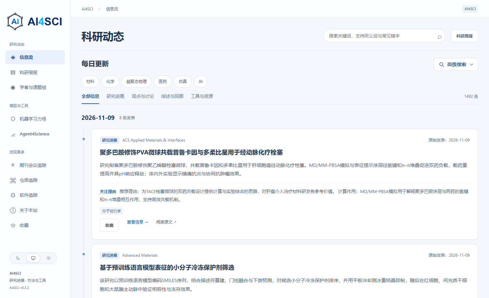
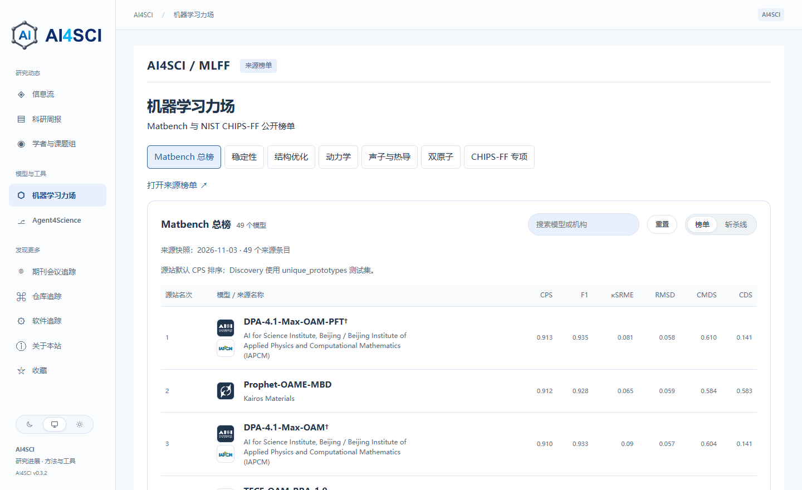

  <picture>
    <source media="(prefers-color-scheme: dark)" srcset="assets/wordmark-dark.svg">
    
  </picture>

# AI4SCI · 科研计算与工业仿真情报

做电池材料的分子动力学模拟，今天有哪些论文值得读？选机器学习力场时，哪个模型在关心的任务上表现更好？常用的科学软件最近发布了什么版本？

AI4SCI 把论文、评测榜单和工具更新放在一个中文网站里，面向材料、化学、医药、凝聚态物理及相关工业应用的研究者。你可以从一个研究问题出发，找到论文、模型或软件，再沿链接回到作者原文、评测榜单或官方公告。

**[打开 AI4SCI][home] · [浏览信源目录](SOURCES.md) · [推荐一个信源][suggest]**

[][home]

## 从你的研究问题开始

| 你现在想做什么 | 从这里开始 |
| --- | --- |
| 看今天有哪些论文值得细读 | [科研动态][home]，按领域和研究主题缩小范围 |
| 补看上周错过的进展 | [科研周报][weekly]，选择周次，按天回顾 |
| 为模拟挑选机器学习力场 | [MLFF 榜单][mlff]，切换稳定性、结构优化、动力学或声子与热导等任务 |
| 跟进常用软件或模型仓库 | [软件追踪][software] 和 [仓库追踪][repos]，找到维护者的官方发布入口 |
| 寻找做相近方向的团队 | [学者与课题组][groups]，搜索姓名、机构或研究方向，再访问课题组主页 |
| 找某个科研环节可用的 Agent | [Agent4Science][agents]，按实验设计、数据分析等任务浏览工具和对应文献 |

## 三种实际用法

### 读论文：从研究问题找到原文

假设你关心分子模拟在药物递送中的应用。进入[科研动态][home]，从「医药」和「仿真」筛选入手。看到感兴趣的论文，先读中文摘要，判断模拟研究了什么对象、支持了什么结论，再通过原文链接核对方法与条件。想留到组会讨论，可以加入[收藏][starred]；收藏保存在当前浏览器。

站点按原始发表日整理研究动态。期刊论文依据作者原始摘要核验主题、实际使用的 AI 或仿真方法及主要结论。符合条件的开放获取论文还可补充全文导读。

### 选力场：先看任务，再看模型

在[机器学习力场榜单][mlff]中，Matbench 总榜提供综合表现。若你关心的是结构优化或热导，可以直接切换到对应任务。想比较模型规模时，点击「斩杀线」，横轴是可训练参数量，纵轴是 Matbench 的 CPS 综合分。沿阶梯查找，就能看到给定参数预算下表现最好的模型。

页面保留来源榜单的顺序和入口。NIST CHIPS-FF 专项可单独查看；比较数值前，可以回到对应来源核对测试集、指标和模型版本。

[][mlff]

### 跟工具：从项目名称找到官方更新

在[软件追踪][software]中搜索 VASP、Quantum ESPRESSO 或 LAMMPS，查看软件用途、关注重点和官方更新入口。在[仓库追踪][repos]中搜索 MOOSE 或 FAIRChem，可以找到代码仓库、最近更新时间和本站检查日期。需要判断某次升级会不会影响现有计算时，从官方 Release 的版本说明查起。

## 我们在跟踪哪些来源？

截至 **2026 年 11 月 10 日**，线上目录收录 **79 个期刊与会议来源、23 项科研软件、44 个代码仓库项目**。下表列出部分例子，完整目录附有官方链接、关注内容和跟踪状态。

| 类型 | 来源举例 | 去哪里看 |
| --- | --- | --- |
| 期刊与会议 | Physical Review Letters、Materials Today Physics、NeurIPS 论文集 | [期刊会议追踪][sources] |
| 科研软件 | VASP、Quantum ESPRESSO、LAMMPS | [软件目录][software] |
| 代码仓库 | MOOSE、FAIRChem、MatGL | [仓库目录][repos] |

**[查看完整信源清单 →](SOURCES.md)**

## 把你常用的信源推荐给大家

如果你经常读一本专业期刊，或长期关注某个科研工具，欢迎先在[信源目录](SOURCES.md)按名称或网址查重，再[提交信源推荐][suggest]。表单只需填三项：**官方链接、类别、值得持续关注的理由**。

理由可以具体到你的工作。例如：“我们用这个库做原子间势训练。它的 Release 会说明模型权重和 ASE 接口的兼容性，升级前需要核对。” 这样的背景有助于判断应该跟踪哪个入口、哪些更新值得报道。维护者会在原 Issue 记录核查结果，接入后补上网站入口。

[home]: https://ai4scihot.8-220-189-127.sslip.io/ai4scihot
[weekly]: https://ai4scihot.8-220-189-127.sslip.io/ai4scihot/weekly
[mlff]: https://ai4scihot.8-220-189-127.sslip.io/ai4scihot/mlff
[software]: https://ai4scihot.8-220-189-127.sslip.io/ai4scihot/software
[repos]: https://ai4scihot.8-220-189-127.sslip.io/ai4scihot/github
[groups]: https://ai4scihot.8-220-189-127.sslip.io/ai4scihot/groups
[agents]: https://ai4scihot.8-220-189-127.sslip.io/ai4scihot/agent4science
[starred]: https://ai4scihot.8-220-189-127.sslip.io/ai4scihot/starred
[sources]: https://ai4scihot.8-220-189-127.sslip.io/ai4scihot/sources
[suggest]: https://github.com/zz11ss11zz/AI4SCINEWS/issues/new?template=source.yml
